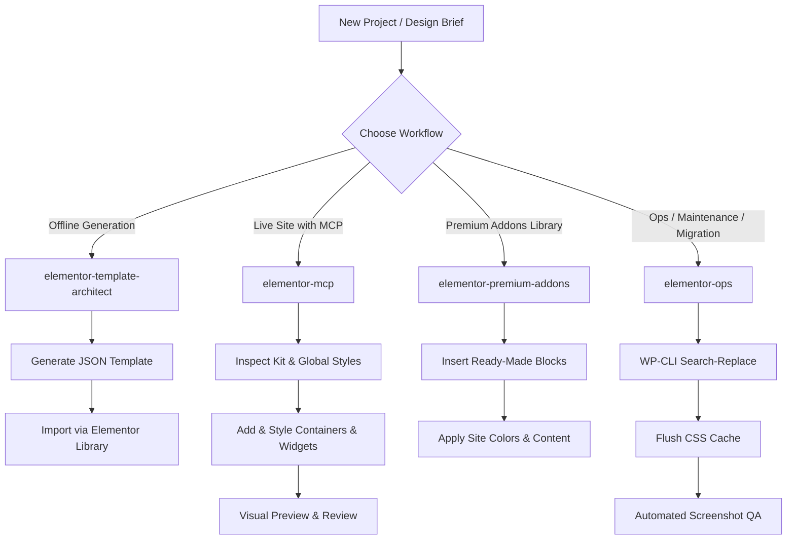

# Elementor Agent Skills Suite

[](LICENSE)
[](https://elementor.com/)
[](https://wordpress.org/)
[](#)

English | [فارسی](README_FA.md)

A modular, enterprise-grade suite of **AI Agent Skills** designed for WordPress and **Elementor (Elementor 4.0+ & 3.x)**. Built for AI coding assistants and autonomous agents (including Google Antigravity, Claude Code, Cursor, Codex, and Windsurf) to reliably design, build, style, inspect, and maintain modern Elementor websites.

---

## 🌟 Overview

Building and maintaining Elementor sites using Large Language Models often leads to brittle HTML blocks, broken container layouts, invalid JSON structures, or accidental live-site regressions.

The **Elementor Agent Skills Suite** solves this by equipping AI agents with specialized, context-aware protocols:
- **Zero brittle code injection**: Strict enforcement of native Elementor widgets (`heading`, `text-editor`, `image`, `button`, `icon-box`, `counter`) instead of raw un-editable HTML blocks.
- **Modern Flexbox Containers**: Native v4+ container-first architecture with strict elimination of legacy Section / Column schemas.
- **Design system integrity**: Schema-first token binding (`__globals__`) for colors and typography instead of hardcoded hex values.
- **RTL & Persian layout mastery**: First-class support for Right-to-Left (RTL) reading directions, font families (Vazirmatn, IRANYekan, Dana), and bidirectional flex alignments.

---

## 🧩 Skills Matrix

The suite is divided into four focused skills tailored to different project phases and operational environments:

| Skill | Primary Focus | Runtime Mode | RTL / Persian Support |
| :--- | :--- | :--- | :---: |
| [`elementor-template-architect`](skills/elementor-template-architect) | Clean, importable Elementor v4+ JSON template generator | Offline / Standalone (Direct JSON output) | Native |
| [`elementor-mcp`](skills/elementor-mcp) | Live WordPress page building and styling via Model Context Protocol (EMCP Tools) | Live via MCP Protocol | Native |
| [`elementor-premium-addons`](skills/elementor-premium-addons) | Pre-built section insertion, advanced widgets & modals via Premium Addons MCP | Live via MCP Protocol | Native |
| [`elementor-ops`](skills/elementor-ops) | Site maintenance, `_elementor_data` search-replace, cache flushes & visual QA | WP-CLI (SSH) + Browser Automation | Native |

---

## 📂 Detailed Skills Breakdown

### 1. `elementor-template-architect`
* **Target**: Generating production-ready, 100% valid Elementor JSON templates offline without requiring an active WordPress connection.
* **Key Highlights**:
  * **Pure Container Architecture**: Generates standard v4+ container hierarchies (`elType: "container"`), eliminating obsolete Section/Column wrappers.
  * **Valid 8-Character Hex IDs**: Generates cryptographically unique 8-character hex IDs (e.g., `4a9b2c1d`) for every element, strictly avoiding collidable timestamps or UUIDs.
  * **Fully Editable Native Widgets**: Constructs complex layouts strictly with native Elementor widgets so users can visually tweak content in the Elementor editor.
  * **Responsive Breakpoints**: Pre-configured values for Desktop, Tablet (`_tablet`), and Mobile (`_mobile`) viewports.
  * **RTL & Typography Presets**: Pre-configured support for RTL directionality and Persian/Arabic typography.

### 2. `elementor-mcp`
* **Target**: Building and editing live pages on WordPress through the **EMCP Tools (v3+)** plugin using the Model Context Protocol.
* **Key Highlights**:
  * **Catalog-Driven Workflow**: Discovers available widgets and retrieves strict schemas before mutating pages (`list-widgets` → `get-widget-schema` → `add-free-widget`).
  * **Global Kit Tokens**: Injects dynamic style references via `__globals__` to maintain site-wide theme styling.
  * **Container Trap Mitigation**: Automatically applies defensive layout fixes, such as setting child container widths to avoid flex shrink/collapse traps.
  * **Accurate Elementor Property Keys**: Uses exact Elementor properties (`flex_gap` instead of `gap`, `padding` instead of `_padding`).

### 3. `elementor-premium-addons`
* **Target**: Supercharging Elementor with the **Premium Addons for Elementor** ecosystem.
* **Key Highlights**:
  * **Pre-Built Section Library**: Rapidly inserts curated sections (Hero sections, Features grids, Testimonials, Pricing tables, CTAs).
  * **Advanced Widgets**: Interacts with complex widgets like Dual-Heading, Interactive Banners, Carousels, and Modal Popups.
  * **Live-Site Safety Rules**: Default-to-draft workflows to prevent accidental overwrites or disruptions on production websites.

### 4. `elementor-ops`
* **Target**: Operational maintenance, troubleshooting, migrations, and automated verification without needing an MCP plugin installed.
* **Key Highlights**:
  * **Database-Safe Content Updates**: Safe search-and-replace routines for Elementor JSON stored within `_elementor_data` via WP-CLI.
  * **Cache Management**: Instant CSS regeneration via `wp elementor flush-css`.
  * **Template Duplication & Migration**: CLI-based cloning and transferring of templates across pages and environments.
  * **Visual QA Loops**: Verification of responsive layouts, rendering, and fonts using Playwright or Chrome browser automation.

---

## 🚀 Installation & Usage

### For Google Antigravity
Copy the skills directory into your Antigravity skills repository:
```bash
# User-level installation (available across all workspaces)
cp -r skills/* ~/.gemini/antigravity/skills/

# Or workspace-level installation
mkdir -p .gemini/skills
cp -r skills/* .gemini/skills/
```

### For Claude Code
Add individual skills or the entire suite to your Claude configuration:
```bash
mkdir -p .claude/skills
cp -r skills/* .claude/skills/
```

### For Cursor, Windsurf, or Custom Agent Frameworks
You can reference the `SKILL.md` files directly in your agent system prompts or custom instructions:
```markdown
Follow the instructions and constraints defined in:
- skills/elementor-template-architect/SKILL.md
- skills/elementor-mcp/SKILL.md
```

---

## 🔄 Recommended Agent Workflows



---

## 🤝 Contributing

Contributions, bug reports, and suggestions are welcome!
1. Fork the repository.
2. Create your feature branch (`git checkout -b feature/awesome-skill`).
3. Commit your changes (`git commit -m 'Add new skill feature'`).
4. Push to the branch (`git push origin feature/awesome-skill`).
5. Open a Pull Request.

---

## 📜 License

This project is licensed under the [MIT License](LICENSE).
Open source and freely available for the WordPress & AI developer community.
