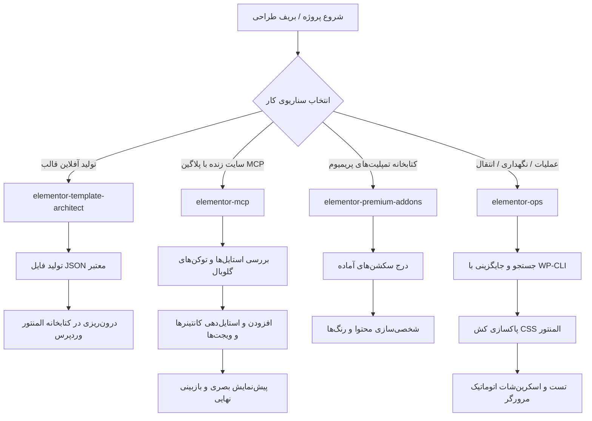

<div dir="rtl">

# مجموعه مهارت‌های المنتور برای ایجنت‌های هوش مصنوعی (Elementor Agent Skills Suite)

[](LICENSE)
[](https://elementor.com/)
[](https://wordpress.org/)
[](#)

[English](README.md) | فارسی

مجموعه‌ای استاندارد، جامع و سازمانی از **مهارت‌های هوش مصنوعی (AI Agent Skills)** ویژه وردپرس و صفحه‌ساز **المنتور (Elementor 4.0+ و 3.x)**. این بسته برای دستیاران کدنویسی و ایجنت‌های خودکار هوش مصنوعی (مانند Google Antigravity، Claude Code، Cursor، Codex و Windsurf) طراحی شده است تا بتوانند با بالاترین دقت، ساختاری استاندارد، بدون باگ‌های رایج و کاملاً واکنش‌گرا صفحات وب را طراحی، ویرایش و مدیریت کنند.

---

## نمای کلی پروژه

طراحی و ویرایش صفحات المنتور توسط مدل‌های زبانی هوش مصنوعی (LLMs) اغلب با مشکلاتی نظیر تزریق کدهای شکننده HTML، به‌هم‌ریختگی کانتینرهای فلکس‌باکس، خروجی‌های نامعتبر JSON یا تغییرات ناخواسته روی سایت‌های زنده همراه است.

**مجموعه مهارت‌های المنتور** این چالش‌ها را از طریق دستورالعمل‌ها و پروتکل‌های تخصصی برطرف می‌کند:
- **عدم استفاده از کدهای شکننده HTML:** اجبار کامل به استفاده از ویجت‌های بومی المنتور (`heading`، `text-editor`، `image`، `button`، `icon-box`، `counter`) جهت حفظ ۱۰۰٪ قابلیت ویرایش بصری توسط کاربر.
- **معماری نوین کانتینرهای فلکس‌باکس (Flexbox Containers):** سازگاری کامل با المنتور نسخه ۴ و ساختار کانتینر‌محور و حذف قطعی ساختارهای منسوخ بخش/ستون (Section/Column).
- **یکپارچگی سیستم طراحی (Design System):** اعمال رنگ‌ها و تایپوگرافی بر اساس متغیرهای گلوبال (`__globals__`) به جای مقادیر هاردکد شده.
- **تسلط بر چیدمان راست‌به‌چپ (RTL) و تایپوگرافی فارسی:** پشتیبانی پیش‌فرض از جهت‌گیری راست‌به‌چپ، فونت‌های استاندارد فارسی (وزیرمتن، ایران‌یکان، دانا) و ترازهای صحیح فلکس در زبان‌های RTL.

---

## جدول مقایسه مهارت‌ها

این مجموعه شامل چهار مهارت تخصصی و مجزا است که متناسب با سناریوی پروژه و سطح دسترسی ایجنت طراحی شده‌اند:

| نام مهارت | تمرکز اصلی | نحوه ارتباط و اجرا | پشتیبانی راست‌به‌چپ / فارسی |
| :--- | :--- | :--- | :---: |
| [`elementor-template-architect`](skills/elementor-template-architect) | معمار تولید قالب‌های JSON استاندارد و قابل درون‌ریزی برای المنتور ۴+ | آفلاین / بدون نیاز به سایت (خروجی مستقیم JSON) | بومی |
| [`elementor-mcp`](skills/elementor-mcp) | طراحی و شخصی‌سازی زنده روی وردپرس از طریق پروتکل MCP (پلاگین EMCP Tools) | اتصال زنده از طریق پروتکل MCP | بومی |
| [`elementor-premium-addons`](skills/elementor-premium-addons) | درج سکشن‌های آماده، ویجت‌های پیشرفته و پاپ‌آپ‌ها با پریمیوم ادانز | اتصال زنده از طریق MCP اختصاصی | بومی |
| [`elementor-ops`](skills/elementor-ops) | نگهداری سایت، تغییر ایمن داده‌های `_elementor_data` با WP-CLI، پاکسازی کش و تست مرورگر | WP-CLI (از طریق SSH) + اتوماسیون مرورگر | بومی |

---

## معرفی تفصیلی مهارت‌ها

### ۱. `elementor-template-architect` (معمار قالب)
* **هدف:** تولید قالب‌های آماده و ۱۰۰٪ معتبر المنتور بدون نیاز به ارتباط زنده با سایت وردپرسی، در قالب فایل استاندارد `.json`.
* **ویژگی‌های برجسته:**
  * **معماری تمام‌کانتینری:** ساخت کانتینرهای تو در تو با خصوصیت `elType: "container"` بدون استفاده از بخش/ستون‌های قدیمی.
  * **تولید شناسه‌های یکتای ۸ کاراکتری:** ایجاد شناسه‌های هگزادسیمال معتبر برای تک‌تک المان‌ها (مانند `4a9b2c1d`) و جلوگیری از تداخل شناسه‌ها.
  * **ویجت‌های بومی و قابل ویرایش:** ساختاردهی کامل متون، دکمه‌ها، تصاویر و شمارنده‌ها با ویجت‌های رسمی المنتور بدون کدهای شکننده داخل ویجت HTML.
  * **نقاط شکست واکنش‌گرا (Breakpoints):** تنظیم مقادیر اختصاصی برای تبلت (`_tablet`) و موبایل (`_mobile`).
  * **پیش‌تنظیمات فارسی و RTL:** تنظیم چیدمان راست‌به‌چپ و استایل‌های بهینه برای زبان فارسی.

### ۲. `elementor-mcp` (طراحی زنده با MCP)
* **هدف:** ساخت، چیدمان و استایل‌دهی زنده روی وردپرس از طریق افزونه **EMCP Tools (v3+)** و پروتکل کانتکست مدل (MCP).
* **ویژگی‌های برجسته:**
  * **جریان کاری مبتنی بر کاتالوگ:** بررسی لیست ویجت‌ها و دریافت اسکیمای دقیق قبل از اعمال تغییرات (`list-widgets` → `get-widget-schema` → `add-free-widget`).
  * **متغیرهای گلوبال کیت (`__globals__`):** فراخوانی پالت‌های رنگی و فونت‌های تم اصلی سایت برای حفظ یکپارچگی بصری.
  * **جلوگیری از باگ‌های انقباض کانتینر:** تنظیم هوشمندانه عرض کانتینرهای فرزند برای ممانعت از جمع‌شدن یا کلاپس ناگهانی در فلکس‌باکس.
  * **استفاده از کلیدهای اختصاصی المنتور:** به‌کارگیری کلیدهای دقیق نظیر `flex_gap` (به جای `gap`) و `padding` (به جای `_padding`).

### ۳. `elementor-premium-addons` (افزونه پرمیوم ادانز)
* **هدف:** بهره‌گیری از ظرفیت‌های افزونه محبوب **Premium Addons for Elementor**.
* **ویژگی‌های برجسته:**
  * **کتابخانه سکشن‌های آماده:** درج سریع بلوک‌های آماده و مدرن (بخش‌های معرفی / Hero، شبکه‌های ویژگی، جدول قیمت‌ها، نظرات مشتریان و فرم‌های تماس).
  * **ویجت‌های پیشرفته:** کار با ویجت‌های حرفه‌ای مانند سرتیتر دوگانه (Dual-Heading)، بنرهای تعاملی، کروسل‌ها و مودال‌ها.
  * **رویکرد امنیتی در سایت‌های فعال:** پیش‌نویس نگه‌داشتن صفحات به صورت پیش‌فرض جهت ممانعت از انتشار تصادفی یا حذف اطلاعات زنده.

### ۴. `elementor-ops` (عملیات و نگهداری سایت)
* **هدف:** مدیریت عملیاتی، اشکال‌زدایی، نگهداری و تست سایت‌های المنتوری بدون نیاز به نصب پلاگین MCP.
* **ویژگی‌های برجسته:**
  * **جستجو و جایگزینی ایمن در دیتابیس:** ویرایش امن ساختار JSON فیلد `_elementor_data` به وسیله WP-CLI بدون شکستن متادیتا.
  * **خالی‌کردن فوری کش استایل‌ها:** بازتولید فایل‌های CSS المنتور با دستور `wp elementor flush-css`.
  * **تکثیر و انتقال قالب‌ها:** کپی و انتقال تمپلیت‌ها و صفحات از طریق خط فرمان.
  * **کنترل کیفیت بصری (Visual QA):** راستی‌آزمایی واکنش‌گرایی و رندر فونت‌ها با ابزارهای مرورگر بدون سر (مانند Playwright).

---

## راهنمای نصب و راه‌اندازی

### در Google Antigravity
کافی است این مهارت‌ها را به پوشه مهارت‌های کاربری یا فضای کاری خود اضافه کنید:
```bash
# نصب سراسری برای همه پروژه‌ها
cp -r skills/* ~/.gemini/antigravity/skills/

# یا نصب در سطح ورک‌اسپیس پروژه
mkdir -p .gemini/skills
cp -r skills/* .gemini/skills/
```

### در Claude Code
برای استفاده در کلات کد، پوشه مهارت‌ها را به مسیر تنظیمات اضافه نمایید:
```bash
mkdir -p .claude/skills
cp -r skills/* .claude/skills/
```

### در Cursor، Windsurf یا سایر فریم‌ورک‌های عامل هوش مصنوعی
می‌توانید فایل‌های `SKILL.md` هر مهارت را به پرامپت سیستم یا دستورالعمل‌های پروژه پیوست کنید:
```markdown
دستورالعمل‌ها و ضوابط تعریف‌شده در فایل‌های زیر را رعایت کنید:
- skills/elementor-template-architect/SKILL.md
- skills/elementor-mcp/SKILL.md
```

---

## نمودار جریان کاری پیشنهادی



---

## مشارکت در توسعه

از پیشنهادات، گزارش خطاها و مشارکت‌های شما استقبال می‌کنیم!

1. مخزن را فورک کنید.<br>
2. یک شاخه جدید بسازید (`git checkout -b feature/new-agent-skill`).<br>
3. تغییرات خود را کامیت کنید (`git commit -m "Add new feature"`).<br>
4. تغییرات را به شاخه خود پوش نمایید (`git push origin feature/new-agent-skill`).<br>
5. یک Pull Request باز کنید.

---

## لایسنس

این پروژه تحت لایسنس [MIT](LICENSE) منتشر شده است.
کاملاً منبع‌باز و رایگان برای جامعه برنامه‌نویسان وردپرس و هوش مصنوعی.

</div>

